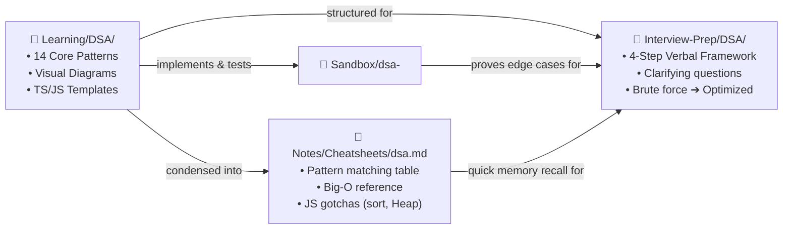

# Data Structures & Algorithms (DSA) Patterns Hub

A pattern-first roadmap to mastering algorithmic problem solving in JavaScript and TypeScript.

---

## Why Patterns Instead of Problems?
There are thousands of LeetCode problems, but almost all of them map to **14 core patterns**. Once you master the mental model, template, and recognition signals of a pattern, you can solve any variation.

---

## The 14 High-Yield Patterns Roadmap

| Phase | # | Pattern | File | Core Data Structures | Canonical Problems |
| :--- | :--- | :--- | :--- | :--- | :--- |
| **Phase 1: Linear Arrays & Strings** | 1 | **Two Pointers** | [01-two-pointers.md](01-two-pointers.md) | Array, String | Two Sum II (Sorted), Valid Palindrome, 3Sum, Container With Most Water |
| | 2 | **Sliding Window** | *Coming Soon* | Array, String, Map | Longest Substring Without Repeating Characters, Min Size Subarray Sum |
| | 3 | **Prefix Sum** | *Coming Soon* | Array, Map | Subarray Sum Equals K, Product of Array Except Self |
| | 4 | **Fast & Slow Pointers** | *Coming Soon* | Linked List, Array | Linked List Cycle, Middle of the Linked List, Happy Number |
| **Phase 2: Ordering & Searching** | 5 | **Modified Binary Search** | *Coming Soon* | Array | Search in Rotated Sorted Array, Find Minimum in Rotated Sorted Array |
| | 6 | **Monotonic Stack** | *Coming Soon* | Stack, Array | Daily Temperatures, Next Greater Element, Largest Rectangle in Histogram |
| | 7 | **Top 'K' Elements (Heap)** | *Coming Soon* | Min/Max Heap | Kth Largest Element, Top K Frequent Elements, Find Median from Data Stream |
| **Phase 3: Trees & Graphs** | 8 | **Tree BFS (Level Order)** | *Coming Soon* | Binary Tree, Queue | Binary Tree Level Order Traversal, Zigzag Traversal, Right Side View |
| | 9 | **Tree DFS (Traversals)** | *Coming Soon* | Binary Tree, Recursion | Maximum Depth, Lowest Common Ancestor, Validate Binary Search Tree |
| | 10 | **Graph BFS & DFS** | *Coming Soon* | Graph, Set, Queue | Number of Islands, Clone Graph, Course Schedule (Topological Sort) |
| **Phase 4: Optimization & Exhaustion** | 11 | **Backtracking** | *Coming Soon* | Recursion, State Tree | Subsets, Permutations, Combination Sum, Word Search |
| | 12 | **1D Dynamic Programming** | *Coming Soon* | Array, Memo Map | Climbing Stairs, House Robber, Coin Change, Longest Increasing Subsequence |
| | 13 | **2D Dynamic Programming** | *Coming Soon* | Matrix / 2D Array | Unique Paths, Longest Common Subsequence, Edit Distance |
| | 14 | **Intervals** | *Coming Soon* | Array, Sorting | Merge Intervals, Insert Interval, Non-overlapping Intervals |

---

## The 4-Way Connected Learning Loop for DSA

---

## Related Hubs
- **Cheatsheet:** [Notes/Cheatsheets/dsa.md](../../Notes/Cheatsheets/dsa.md)
- **Hands-on Experiment:** [Sandbox/dsa-two-pointers/](../../Sandbox/dsa-two-pointers/README.md)
- **Interview Q&A:** [Interview-Prep/DSA/two-pointers-interview-qa.md](../../Interview-Prep/DSA/two-pointers-interview-qa.md)
