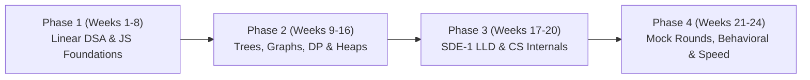

# Road to FAANG: SDE-1 Preparation Tracker (6-Month Plan)

> **Target:** Software Development Engineer 1 (SDE-1) at Tier-1 Tech (Meta, Google, Amazon, Microsoft, Uber, Stripe).  
> **Primary Language:** JavaScript / TypeScript.  
> **Timeline:** 6 Months (24 Weeks).  
> **Core Focus:** 70% DSA & Problem Solving, 15% JS/Node.js Runtime Internals, 10% Low-Level Design (LLD), 5% Behavioral (STAR).

---

## 6-Month Milestone Roadmap

---

## Phase 1: Linear DSA Patterns & JavaScript Foundations (Weeks 1–8)

Focus: Master array/string patterns, pointer movements, window sizing, and clean $O(1)$ space logic.

| Week | Target Pattern / Topic | Status | Concept Note | Practice & Verification |
| :---: | :--- | :---: | :--- | :--- |
| **W1** | **Pattern 1: Two Pointers** | ✅ Completed | [01-two-pointers.md](DSA/01-two-pointers.md) | [two-pointers.test.js](../Sandbox/dsa-two-pointers/two-pointers.test.js) |
| **W2** | **Pattern 2: Sliding Window (Fixed & Dynamic)** | 🟡 In Progress | [02-sliding-window.md](DSA/02-sliding-window.md) | [Sandbox Demo](../Sandbox/dsa-sliding-window/README.md) |
| **W3** | **Pattern 3: Prefix Sum & Hash Maps** | ⚪ Not Started | *Coming Soon* | Subarray Sum Equals K |
| **W4** | **Pattern 4: Fast & Slow Pointers (Floyd's Cycle)** | ⚪ Not Started | *Coming Soon* | Linked List Cycle, Happy Number |
| **W5** | **Pattern 5: Modified Binary Search** | ⚪ Not Started | *Coming Soon* | Rotated Array, Boundary Search |
| **W6** | **Pattern 6: Monotonic Stack** | ⚪ Not Started | *Coming Soon* | Daily Temperatures, Next Greater |
| **W7** | **JavaScript Engine & V8 Quirks for Coding** | ⚪ Not Started | *Coming Soon* | Array.sort gotchas, Heap memory limits |
| **W8** | **Phase 1 Review & 10-Problem Timed Checkpoint** | ⚪ Not Started | — | 2 Mediums in 45 Mins |

---

## Phase 2: Non-Linear DSA (Trees, Graphs, Heaps, DP) (Weeks 9–16)

Focus: Recursion state trees, graph traversals, and dynamic programming memoization.

| Week | Target Pattern / Topic | Status | Canonical FAANG Problems |
| :---: | :--- | :---: | :--- |
| **W9** | **Pattern 7: Top 'K' Elements (Heap / Priority Queue)** | ⚪ Not Started | Kth Largest, Top K Frequent (Custom JS MinHeap) |
| **W10** | **Pattern 8: Tree BFS (Level Order)** | ⚪ Not Started | Binary Tree Level Order, Right Side View |
| **W11** | **Pattern 9: Tree DFS (Traversals & Recursion)** | ⚪ Not Started | Lowest Common Ancestor, Max Path Sum, Validate BST |
| **W12** | **Pattern 10: Graph BFS & DFS (Grid & Adjacency)** | ⚪ Not Started | Number of Islands, Max Area of Island, Clone Graph |
| **W13** | **Pattern 11: Graph Topological Sort & Cycles** | ⚪ Not Started | Course Schedule I & II, Alien Dictionary |
| **W14** | **Pattern 12: Backtracking (State Trees)** | ⚪ Not Started | Subsets, Permutations, Combination Sum, Word Search |
| **W15** | **Pattern 13: 1D Dynamic Programming** | ⚪ Not Started | Climbing Stairs, House Robber, Coin Change, LIS |
| **W16** | **Pattern 14: 2D Dynamic Programming & Intervals** | ⚪ Not Started | Unique Paths, Longest Common Subsequence, Merge Intervals |

---

## Phase 3: SDE-1 Clean Code, LLD & CS Internals (Weeks 17–20)

Focus: Writing production-grade in-memory data structures, modular classes, and deep CS concepts.

| Week | Topic | Status | Key Problems / Concepts |
| :---: | :--- | :---: | :--- |
| **W17** | **In-Memory LLD: LRU & LFU Cache** | ⚪ Not Started | Hash Map + Doubly Linked List in JavaScript |
| **W18** | **In-Memory LLD: Trie & Rate Limiter** | ⚪ Not Started | Prefix Tree (Autocomplete), Token Bucket Rate Limiter |
| **W19** | **Node.js & JavaScript Runtime Mastery** | ✅ Core Done | Event loop phases, microtasks vs macrotasks, non-blocking I/O |
| **W20** | **Operating Systems & Networking for SDE-1** | ⚪ Not Started | Process vs Thread, Virtual Memory, TCP 3-Way Handshake, DNS |

---

## Phase 4: Mock Rounds, Behavioral & Peak Speed (Weeks 21–24)

Focus: Verbal delivery under pressure, time management, and behavioral storytelling.

| Week | Focus | Deliverable |
| :---: | :--- | :--- |
| **W21** | **Behavioral Story Bank (STAR Method)** | 10 polished stories mapped to Amazon Leadership & Googleyness |
| **W22** | **Timed Mock Rounds (LeetCode Mediums)** | 2 problems in 45 minutes on a blank whiteboard / CoderPad |
| **W23** | **Full 4-Round Simulation** | 2 DSA rounds + 1 JS Internals/LLD round + 1 Behavioral round |
| **W24** | **Final Polish & Revision** | Review [Notes/Cheatsheets/](Notes/README.md) and weak spots |

---

## Live Progress Checklist
- [x] Workspace Architecture & 4-way linked pipeline established
- [x] Git repository configured & pushed to GitHub
- [x] Node.js Core Runtime Pillars completed (01-05)
- [x] Pattern 1: Two Pointers completed
- [ ] Pattern 2: Sliding Window completed
- [ ] Pattern 3: Prefix Sum completed
