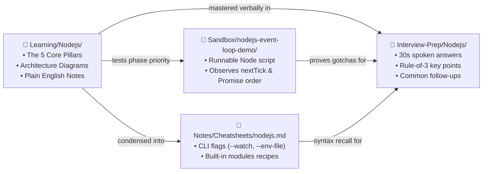

# Node.js Learning Notes

A beginner-friendly guide to core Node.js runtime mechanics, written in simple, short, and interview-ready English.

---

## What is Node.js?

> Node.js is an open-source, cross-platform JavaScript runtime environment built on Chrome's V8 engine and Libuv that executes JavaScript outside the browser.

### The Problem Node.js Solves
- **Traditional Servers (Apache / Java):** Allocate one heavy OS thread per client request. At 10,000 connections, servers run out of memory from thread stacks and CPU context switching.
- **Node.js:** Uses an event-driven, single-threaded execution model with non-blocking I/O to handle tens of thousands of concurrent connections with minimal memory.

---

## Core Topics (The 5 Fundamental Pillars)

| # | Topic | File | What You Learn |
| :- | :--- | :--- | :--- |
| 1 | **Node.js Architecture** | [01-nodejs-architecture.md](01-nodejs-architecture.md) | V8 engine, Libuv, C++ bindings, and the hidden thread pool. |
| 2 | **Event Loop** | [02-event-loop.md](02-event-loop.md) | The 6 phases of the loop, microtasks vs macrotasks, and priority queues. |
| 3 | **Blocking vs Non-Blocking** | [03-blocking-vs-non-blocking.md](03-blocking-vs-non-blocking.md) | Thread starvation, the 3 blocking traps, and how to keep the loop free. |
| 4 | **Synchronous vs Asynchronous** | [04-synchronous-vs-asynchronous.md](04-synchronous-vs-asynchronous.md) | Execution timing, Call Stack mechanics, and modern Promises / async-await. |
| 5 | **Concurrent Requests** | [05-concurrent-requests.md](05-concurrent-requests.md) | How a single thread handles 10,000 requests via I/O multiplexing (`epoll`/`kqueue`). |

---

## The 4-Way Connected Learning Loop for Node.js

---

## Related Hubs
- **Cheatsheet:** [Notes/Cheatsheets/nodejs.md](../../Notes/Cheatsheets/nodejs.md)
- **Hands-on Experiment:** [Sandbox/nodejs-event-loop-demo/](../../Sandbox/nodejs-event-loop-demo/README.md)
- **Interview Q&A:** [Interview-Prep/Nodejs/nodejs-interview-qa.md](../../Interview-Prep/Nodejs/nodejs-interview-qa.md)
