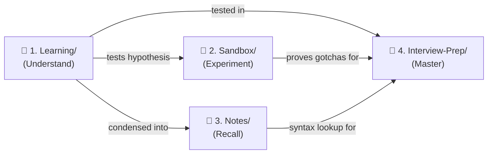

# Developer Knowledge & Practice Hub

An integrated engineering knowledge system for continuous learning, hands-on experimentation, daily cheatsheets, and interview readiness.

---

## The 4-Way Knowledge Architecture

| Section | Role | Guidelines | What's Inside |
| :--- | :--- | :--- | :--- |
| [**`Learning/`**](Learning/Docker/README.md) | **Deep Dives in Plain English** | Short, clear explanations with analogies and diagrams | [Docker](Learning/Docker/README.md), [Redis](Learning/Redis/README.md), [Node.js](Learning/Nodejs/README.md), [DSA](Learning/DSA/README.md) |
| [**`Sandbox/`**](Sandbox/README.md) | **Runnable Prototypes & Probes** | Self-contained experiments with zero external baggage | Event loop tests, Docker volumes, Redis cache spikes, Two pointers test runner |
| [**`Notes/`**](Notes/README.md) | **3-Second Daily Cheatsheets** | Syntax tables and zero-fluff command lookup | Docker CLI, Redis CLI, Node.js built-ins, DSA Big-O & Pattern Matrix |
| [**`Interview-Prep/`**](Interview-Prep/README.md) | **Verbal Mastery & Coding Q&A** | 30s spoken answers, rule-of-3 key points, follow-ups | High-frequency Docker, Redis, Node.js, and DSA interview questions |

*(Note: [**`Projects/`**](Projects/README.md) is kept separate for standalone applications with their own repositories.)*

---

## System Guidelines & Navigation

- **Workspace Operating Guide:** [guide.md](guide.md)
- **Agent Rules & Conventions:** [.agents/rules/](.agents/rules)
  - [learning-notes.md](.agents/rules/learning-notes.md): Plain English writing constraints
  - [sandbox.md](.agents/rules/sandbox.md): Experiment self-containment & hygiene
  - [notes.md](.agents/rules/notes.md): Fast 3-second recall formatting
  - [interview-prep.md](.agents/rules/interview-prep.md): 4-step verbal response structure
