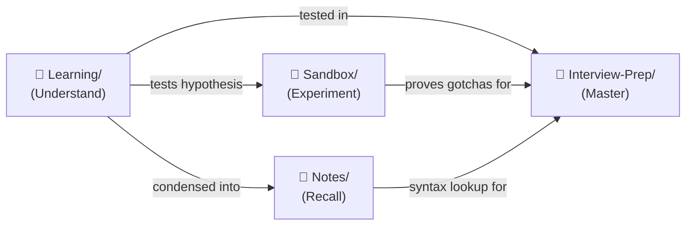

# Developer Workspace Guide

A simple folder system for coding, learning, interview preparation, and experiments.

## Folder Structure

```text
Developer/
├── Projects/
├── Learning/
├── Interview-Prep/
├── Notes/
├── Sandbox/
└── README.md

Personal/
Inbox/
```

## How to Use Each Folder

### 1. Projects/

**Purpose:** Build and maintain real applications or substantial tools.

Use for:

- Personal and portfolio projects
- Side projects and production-ready applications
- Open-source contributions
- Projects you want to maintain long-term

Example:

```text
Projects/
├── expense-tracker/
├── portfolio/
└── ai-resume-analyzer/
```

**Rule:** If you're building something substantial, put it here.

### 2. Learning/

**Purpose:** Learn new technologies through tutorials, courses, and practice.

Use for:

- Programming languages and frameworks
- AI/ML and new technologies
- Course exercises and tutorial code
- Learning experiments you want to keep

Example:

```text
Learning/
├── Python/
├── React/
├── TypeScript/
└── AI-ML/
```

**Rule:** If the goal is learning a technology, put it here.

### 3. Interview-Prep/

**Purpose:** Prepare for technical interviews and job opportunities.

Use for:

- Data Structures and Algorithms (DSA)
- System design
- Behavioral interview preparation
- Mock interviews and revision

Example:

```text
Interview-Prep/
├── DSA/
├── System-Design/
├── Behavioral/
└── Mock-Interviews/
```

**Rule:** If you're doing it specifically for interview preparation, put it here.

### 4. Notes/

**Purpose:** Store reusable technical knowledge for future reference.

Use for:

- Programming concepts and explanations
- Git and terminal commands
- Database queries and debugging solutions
- Cheatsheets and useful references
- Lessons learned while solving problems

Example:

```text
Notes/
├── Programming/
├── Backend/
├── Databases/
├── DevOps/
└── Cheatsheets/
```

**Rule:** If you want to remember or quickly look up something later, put it here.

### 5. Sandbox/

**Purpose:** Try things out without creating a permanent project.

Use for:

- Quick code snippets
- API experiments
- Testing unfamiliar libraries
- Small AI prototypes
- Temporary proof-of-concept code

**Rule:** If you're just experimenting, put it here. Promote useful experiments to `Projects/` and delete abandoned ones.

### 6. Personal/

**Purpose:** Organize files unrelated to software development.

Use for:

- Personal documents
- Finance and budgeting
- Travel plans
- Hobbies and personal projects

**Rule:** Keep non-coding personal files here.

### 7. Inbox/

**Purpose:** Temporarily hold files you haven't organized yet.

Use for:

- Files you download and need to sort
- Documents you receive
- Miscellaneous files whose destination isn't immediately clear

## The Connected Knowledge Pipeline

The 4 folders—`Learning/`, `Sandbox/`, `Notes/`, and `Interview-Prep/`—work together as an integrated developer learning loop:



| Folder | Focus | Agent Rule | Primary Hub |
| :--- | :--- | :--- | :--- |
| **`Learning/`** | Concept deep dives in plain English | [learning-notes.md](.agents/rules/learning-notes.md) | [Learning/README.md](Learning/Docker/README.md) |
| **`Sandbox/`** | Minimal runnable spikes & prototypes | [sandbox.md](.agents/rules/sandbox.md) | [Sandbox/README.md](Sandbox/README.md) |
| **`Notes/`** | Fast 3-second cheatsheets & commands | [notes.md](.agents/rules/notes.md) | [Notes/README.md](Notes/README.md) |
| **`Interview-Prep/`** | 30s spoken answers & technical Q&A | [interview-prep.md](.agents/rules/interview-prep.md) | [Interview-Prep/README.md](Interview-Prep/README.md) |

*(Note: `Projects/` remains independent for standalone, production-ready code repositories.)*

## Quick Decision Guide

| If you're...                   | Use this folder   |
| ------------------------------ | ----------------- |
| Building an application        | `Projects/`       |
| Learning a technology          | `Learning/`       |
| Preparing for interviews       | `Interview-Prep/` |
| Saving reusable knowledge      | `Notes/`          |
| Testing an idea                | `Sandbox/`        |
| Managing personal files        | `Personal/`       |
| Unsure where something belongs | `Inbox/`          |

## Workspace Rules

1. Create folders only when you actually need them.
2. Use descriptive, lowercase names with hyphens, such as `ai-resume-analyzer`.
3. Avoid keeping duplicate copies of the same files.
4. Use Git for version control of code projects.
5. Never commit secrets, passwords, API keys, or `.env` files.
6. Keep generated files and dependencies out of Git when appropriate.
7. Move successful experiments from `Sandbox/` to `Projects/`.
8. Review `Inbox/` and clean up `Sandbox/` weekly.
9. Back up important work; Git alone is not a backup for every file.
10. Prefer a simple structure over creating unnecessary subfolders.

## The Golden Rule

**Build → Projects | Learn → Learning | Prepare → Interview-Prep | Remember → Notes | Experiment → Sandbox**

Keep this structure consistent. Add new folders only when a real need arises.
